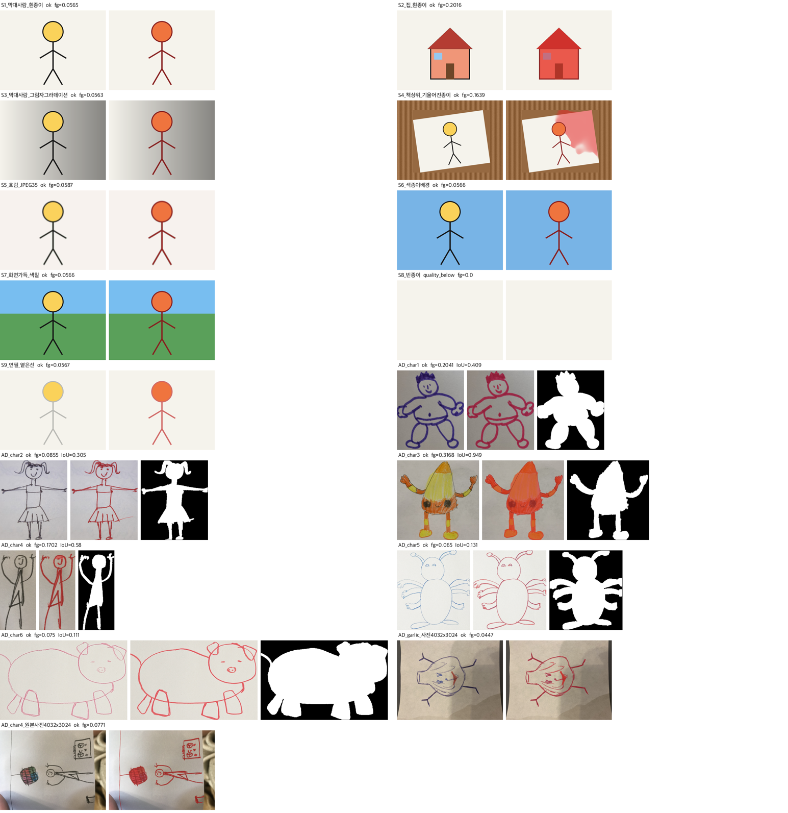

# M1 BiRefNet 시험 기록

> 기록: 2026-09-29 · 원본 폴더 `/Users/pioneer1/project2610`, Studio-B.local(M1 Ultra, 128GB, 공유 호스트 load 3.8~6.5)
> 목적: M1은 재현 기록(`docs/기록/A/A_모델재현기록.md` M1·M2·M5 절)에 그림 2장(막대 사람·빈 종이)만 확인돼 있었다. 따로 된 시험 기록이 없어서, **실제 어댑터를 그대로 불러** 촬영 조건·실제 아이 그림·오류 경로·자원을 넓혀 시험했다. 새로 내려받지 않고 이미 받은 가중치를 검증한 뒤 썼다.
> 관련: `serving/adapters/m1_birefnet.py` · `serving/tests/test_real_m1.py` · `models/manifest.yaml` M1 · `serving/config/thresholds.yaml` split · `serving/config/limits.yaml` split · REF §2 M1 · BR-FBK-02 · FR-20·22

## 1. 결론

| 항목 | 결과 |
|---|---|
| 가중치 무결성 | ✅ SHA-256·HF 리비전이 매니페스트와 같다 |
| 기존 실제 시험 `test_real_m1.py` | ✅ **1 passed**(24.1초), 막대 사람 전경 5.7%·빈 종이 `quality_below` — 재현 기록과 같다 |
| 어댑터 동작(19건) | ✅ 결과 코드·산출물 모두 계약대로. 원본 RGB 불변(FR-22) 16/16, 크기·RGBA 16/16 |
| 오류 경로 | ✅ 빈 종이 → `quality_below`/`split_fail`, 깨진 파일 → `storage`/`input_unreadable`, 취소 → `engine_down`/`cancelled_midway` |
| 결정성 | ✅ 같은 입력 3회 전경 비율이 소수점 끝자리까지 같다 |
| 속도 | ✅ 7.6~9.7초/장(800×600~564×547), 4032×3024 사진 11.9~12.7초 — `limits.yaml` split 시간 상한 60초 안 |
| 메모리 | ⚠️ 최대 RSS **9.37GB**(적재 직후 1.7GB → 첫 추론 8.9GB). 재현 기록의 8.5GB보다 조금 높다. split 동시 처리 1(`fc5b250`)이 맞다 |
| **분리 품질(선 그림)** | ❌ **선만 떼고 안쪽을 비운다.** AD 예제 6장 사람 주석 마스크와 IoU 평균 **0.414**(0.111~0.949). 안쪽까지 칠한 그림(char3)만 0.949 |
| 구멍 채우기를 하면 | 🔎 결과 마스크에 구멍 채우기만 해도 IoU 평균 **0.883**, 닫힘 7px + 채우기는 **0.892**(아래 §5). 코드는 바꾸지 않았다 |

M1 엔진과 어댑터는 **계약대로 동작한다.** 다만 아이 그림 대부분이 **선 그림**이라, 지금 마스크를 그대로 2.5D(M5)에 쓰면 **선만 튀어나오고 몸 안쪽은 종이로 남는다.** 2.5D 마스크의 기본 출처가 M1이므로(BR-FBK-02) 켜기 전에 팀 판단이 필요하다(§6).

시험 입력은 합성 그림과 AD 예제 그림이다. **평가 묶음 측정이 아니다**(BR-MDL-04, `eval/items/manifest.yaml`은 팀원 작품만). 1차 측정은 T118·T137에서 한다.

## 2. 대상과 환경

| 무엇 | 값 |
|---|---|
| 모델 | `ZhengPeng7/BiRefNet` 리비전 `e2bf8e4460fc8fa32bba5ea4d94b3233d367b0e4` |
| 가중치 | `models/hf/models--ZhengPeng7--BiRefNet/snapshots/e2bf8e44…/model.safetensors` (git 제외) |
| SHA-256 | 기록값 `9ab37426…a154` = 실측 `9ab37426bf4de0567af6b5d21b16151357149139362e6e8992021b8ce356a154` ✅ |
| 실행 환경 | `serving/.venv`(Python 3.11) · torch 2.4.1 · transformers 4.44.2 · **CPU**(MPS에 `deform_conv2d` 없음, 재현 기록) |
| 어댑터 설정 | 입력 1024×1024, ImageNet 정규화, 임계 0.5, 전경 비율 허용 0.02~0.98(`thresholds.yaml`) |
| 적재 시간 | 2.5~2.8초(캐시 있음) |

## 3. 절차

```bash
# 1) 가중치 검증
shasum -a 256 models/hf/models--ZhengPeng7--BiRefNet/snapshots/*/model.safetensors

# 2) 기존 실제 시험
cd serving && UAM_REAL_MODELS=1 .venv/bin/python -m pytest -q -s tests/test_real_m1.py

# 3) 확장 시험 — 시험 스크립트(세션 임시 폴더)가 BiRefNetAdapter를 한 번 적재하고
#    JobInput(split)으로 아래 19건 + 취소 1건 + 반복 3회를 차례로 부른다.
#    AD 예제는 characters/char1~6/texture.png(잘린 그림, 배경 포함)를 입력으로, 같은 폴더 mask.png를 정답으로 IoU를 잰다.
#    결과 마스크를 원본 위에 빨갛게 겹쳐 한 장으로 모았다(§4 그림).
```

입력 목록:

| 묶음 | 건 | 내용 |
|---|---|---|
| S 합성 | 9 | S1 막대 사람(흰 종이) · S2 집 · S3 그림자 그라데이션 · S4 책상 위 8° 기울어진 종이 · S5 흐림+JPEG 35 · S6 색종이 배경 · S7 화면 가득 색칠 · S8 빈 종이 · S9 연필 옅은 선 |
| AD 예제(정답 있음) | 6 | `models/m3/AnimatedDrawings/examples/characters/char1~6` — 실제 아이 그림 사진을 자른 것, 사람 주석 마스크 |
| AD 원본 사진 | 2 | `drawings/garlic.png`, `characters/char4/original_img.png` (둘 다 4032×3024 휴대폰 사진) |
| 오류 | 2 | E1 깨진 파일, E2 취소 신호가 켜진 채 호출 |
| 반복 | 1 | S1을 3회 |

## 4. 결과



| 건 | 결과 | 전경 비율 | 시간(초) | IoU(정답 대비) | 눈으로 본 것 |
|---|---|---:|---:|---:|---|
| S1 막대 사람 | ok | 0.057 | 8.5 | — | 선과 얼굴 전부 잡음 |
| S2 집 | ok | 0.202 | 8.0 | — | 집 전체(채워진 면) 깔끔 |
| S3 그림자 그라데이션 | ok | 0.056 | 8.0 | — | 그림자 무시, 그림만 |
| S4 책상 위 기울어진 종이 | ok | 0.164 | 8.3 | — | ⚠️ 그림은 잡았지만 **종이 오른쪽 위 빈 곳에 번진 얼룩**이 전경으로 들어감. 책상은 제외 |
| S5 흐림+JPEG 35 | ok | 0.059 | 8.1 | — | 흐린 경계도 잡음 |
| S6 색종이 배경 | ok | 0.057 | 9.7 | — | 배경색 무시 |
| S7 화면 가득 색칠 | ok | 0.057 | 9.1 | — | 하늘·땅 색칠은 배경으로 보고 사람만. 98% 초과 실패는 나지 않음 |
| S8 빈 종이 | quality_below(`split_fail`) | 0.000 | 7.7 | — | 계약대로 |
| S9 연필 옅은 선 | ok | 0.057 | 8.6 | — | 옅은 선도 잡음 |
| AD char1 | ok | 0.204 | 8.4 | 0.409 | ❌ 외곽선만, 몸 안쪽 비움 |
| AD char2 | ok | 0.086 | 7.6 | 0.305 | ❌ 선만 |
| AD char3 | ok | 0.317 | 8.2 | **0.949** | ✅ 안쪽을 칠한 그림은 거의 정답 |
| AD char4 | ok | 0.170 | 7.6 | 0.580 | 선만(막대형이라 손실이 적음) |
| AD char5 | ok | 0.065 | 7.8 | 0.131 | ❌ 선만 |
| AD char6 | ok | 0.075 | 8.1 | 0.111 | ❌ 선만(돼지 몸통 전체가 빠짐) |
| AD garlic 사진 | ok | 0.045 | 11.9 | — | 선 전부 잡음, 종이 주름·그림자 무시 |
| AD char4 원본 사진 | ok | 0.077 | 12.7 | — | ⚠️ 그림 외에 **공책 세로 여백선·오른쪽 아래 손가락 쪽 물체**도 잡음 |
| E1 깨진 파일 | storage(`input_unreadable`) | — | 1.1 | — | 계약대로 |
| E2 취소 신호 | engine_down(`cancelled_midway`) | — | — | — | 계약대로 |
| 반복 3회(S1) | ok×3 | 0.05653×3 | 8.3·7.6·7.9 | — | 결정적 |

자원: 적재 전 0.14GB → 적재 1.7GB → 첫 추론 8.94GB → 최대 **9.37GB**(색종이 건부터 고정).

## 5. 구멍 채우기 측정 (참고, 코드 변경 없음)

결과 마스크를 이진화(>127)한 뒤 바깥 테두리에서 채우기를 해 닫힌 안쪽을 전경으로 바꿔 IoU만 다시 쟀다.

| | char1 | char2 | char3 | char4 | char5 | char6 | 평균 |
|---|---:|---:|---:|---:|---:|---:|---:|
| 지금(원 마스크) | 0.409 | 0.305 | 0.949 | 0.580 | 0.131 | 0.111 | **0.414** |
| 구멍 채우기 | 0.961 | 0.827 | 0.949 | 0.800 | 0.797 | 0.962 | **0.883** |
| 닫힘 7px + 채우기 | 0.963 | 0.839 | 0.951 | 0.810 | 0.825 | 0.964 | **0.892** |

- 선이 닫혀 있는 그림(char1·6)은 채우기만으로 정답과 거의 같아진다.
- char2·5는 팔다리가 한 줄 선이라 정답(두께 있는 팔다리)과 차이가 남는다. 닫힘을 넣으면 조금 좋아진다.
- 이미 칠한 그림(char3)은 바뀌지 않는다 — 채우기가 해를 주지 않는다.
- 이 처리는 원본 픽셀을 건드리지 않고 알파(마스크)만 바꾸므로 FR-22와 충돌하지 않는다.

## 6. 발견과 제안 (팀 판단 필요)

| # | 발견 | 영향 | 제안 |
|---|---|---|---|
| 1 | 선 그림에서 선만 전경으로 잡는다 | 2.5D(M5)가 선만 튀어나온 부조가 된다. `segment` 외부 API 결과도 같은 형태 | 어댑터에 **구멍 채우기(+작은 닫힘) 후처리**를 넣는 안. 절대 규정에 따라 **설계서(REF §2 M1·SD_01 split·research R-22·contracts stage-job) 먼저 반영 → 구현** 순서로 한다. 담당(A) 결정 |
| 2 | 선 그림의 전경 비율이 4.5~8.6%로 낮다 | 하한 2%에 가깝다. 더 가늘거나 작은 그림은 **분리를 잘했는데도 `split_fail`**로 떨어질 수 있다 | #1을 넣으면 비율이 올라가 자연히 풀린다. 넣지 않으면 U5(품질 기준) 확정 때 하한을 다시 본다 |
| 3 | 촬영 사진에서 여백선·손가락·종이 얼룩을 함께 잡는 경우가 있다(S4, char4 원본) | 컷아웃에 잡티가 섞인다 | 가장 큰 연결 영역만 남기는 후처리는 여러 조각 그림을 잘라낼 수 있어 권하지 않는다. 평가 묶음 capture_condition 6건(T118)으로 먼저 잰다 |
| 4 | 최대 RSS 9.37GB | 공유 호스트 부담 | split 동시 처리 1 유지(`limits.yaml`, `fc5b250`). 재현 기록의 8.5GB를 9.4GB로 고쳐 적을지 A가 판단 |

라이선스(MIT)와 켜기 권고(`docs/기록/A/A_모델_라이선스_확정.md` §4 "켬")는 이 시험으로 바뀌지 않는다. 다만 #1을 풀기 전에 켜면 2.5D 결과 품질이 기대에 못 미친다는 점을 U4 확정 회의에 함께 올린다.

## 7. 정리

- 시험 산출물(마스크·컷아웃·결과 JSON)은 세션 임시 폴더에만 두었고 저장소에 넣지 않았다. 결과 모음 그림만 `docs/기록/D/M1_BiRefNet_시험결과.png`로 남겼다.
- 공유 서버의 상주 프로세스는 건드리지 않았다(worker·model-api 재시작 없음). 시험 프로세스는 끝나면서 메모리를 돌려줬다.
